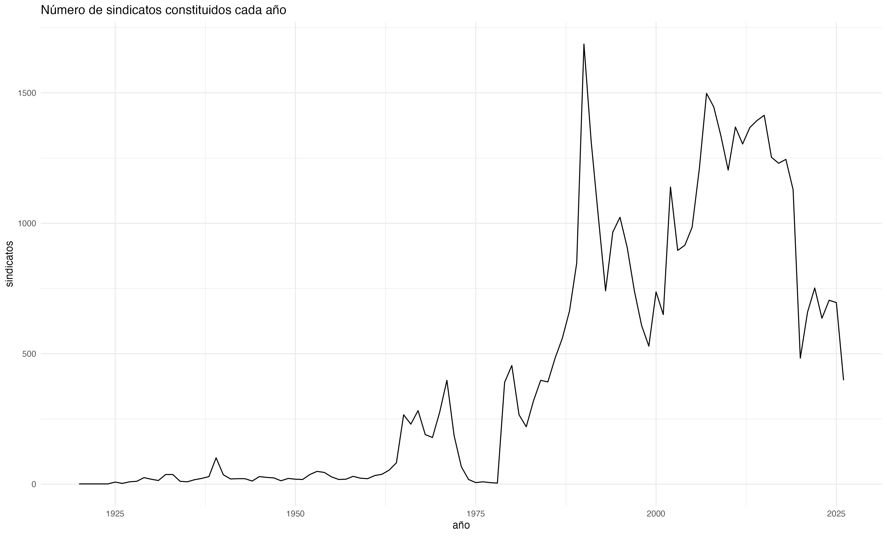
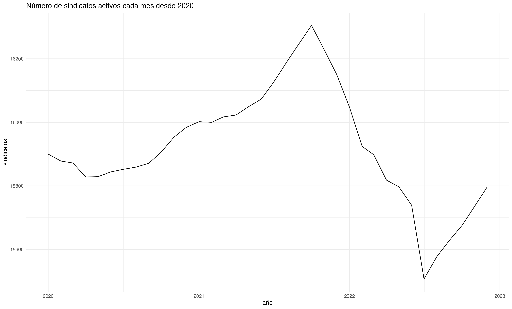

# sindicatoscl 

Paquete R para acceder a microdato de sindicatos activos y en receso en
Chile, proveniente de registro administrativo de la Dirección del
Trabajo.

# Instalar y cargar paquete

El paquete no se encuentra en la CRAN ni ha sido enviado, por lo que
debe instalarse la versión en desarrollo desde GitHub.

``` r
install.packages("devtools")
devtools::install_github("nicolasrattor/sindicatoscl")
```

``` r
library(sindicatoscl)
```

Además, se cargan otros paquetes para la manipulación de datos:

``` r
library(dplyr)
library(ggplot2)
```

# Uso del paquete

## Obtener microdatos de sindicatos

El objetivo principal del paquete es disponer de una *dataframe* con el
listado de todos los sindicatos activos y en receso en Chile y, sus
principales características.

El *dataframe* `sindicatos` contiene 45792 observaciones para 15
variables:

<table>
<thead>
<tr>
<th style="text-align:left;">
variables
</th>
<th style="text-align:left;">
descripción
</th>
</tr>
</thead>
<tbody>
<tr>
<td style="text-align:left;width: 10cm; ">
region
</td>
<td style="text-align:left;width: 10cm; ">
Región de la dirección a la que se asocia el sindicato. Suele ser la de
la casa matriz de la empresa (16 regiones)
</td>
</tr>
<tr>
<td style="text-align:left;width: 10cm; ">
rsu_raf
</td>
<td style="text-align:left;width: 10cm; ">
Identificador del sindicato
</td>
</tr>
<tr>
<td style="text-align:left;width: 10cm; ">
nombre
</td>
<td style="text-align:left;width: 10cm; ">
Nombre del sindicato
</td>
</tr>
<tr>
<td style="text-align:left;width: 10cm; ">
estado
</td>
<td style="text-align:left;width: 10cm; ">
Estado del sindicato: ACTIVO, RECESO, DISUELTO, CADUCADO O ELIMINADO
</td>
</tr>
<tr>
<td style="text-align:left;width: 10cm; ">
tipo
</td>
<td style="text-align:left;width: 10cm; ">
Tipo de organización: EMPRESA, ESTABLECIMIENTO, INDEPENDIENTE, INTER
EMPRESA, TRANSITORIO, ASOCIACION DE FUNCIONARIOS, FEDERACION DE
SINDICATOS, FEDERACION DE ASOCIACIONES, CONFEDERACION DE SINDICATOS,
CONFEDERACION DE ASOCIACIONES o CENTRAL DE TRABAJADORES
</td>
</tr>
<tr>
<td style="text-align:left;width: 10cm; ">
direccion
</td>
<td style="text-align:left;width: 10cm; ">
Dirección a la que se asocia el sindicato. Suele ser la de la casa
matriz de la empresa
</td>
</tr>
<tr>
<td style="text-align:left;width: 10cm; ">
socios
</td>
<td style="text-align:left;width: 10cm; ">
Número de socios de sindicato registrados en último trámite
</td>
</tr>
<tr>
<td style="text-align:left;width: 10cm; ">
socias
</td>
<td style="text-align:left;width: 10cm; ">
Número de socias de sindicato registrados en último trámite
</td>
</tr>
<tr>
<td style="text-align:left;width: 10cm; ">
fecha_constitucion
</td>
<td style="text-align:left;width: 10cm; ">
Fecha de constitución del sindicato
</td>
</tr>
<tr>
<td style="text-align:left;width: 10cm; ">
fecha_ultima_directiva
</td>
<td style="text-align:left;width: 10cm; ">
Fecha de elección de directiva. Se usa como proxy de último trámite
</td>
</tr>
<tr>
<td style="text-align:left;width: 10cm; ">
nombre_oficina
</td>
<td style="text-align:left;width: 10cm; ">
Nombre oficina de Inspección del Trabajo en que se hizo la constitución
del sindicato
</td>
</tr>
<tr>
<td style="text-align:left;width: 10cm; ">
empresa
</td>
<td style="text-align:left;width: 10cm; ">
Nombre de la empresa
</td>
</tr>
<tr>
<td style="text-align:left;width: 10cm; ">
rut_empresa
</td>
<td style="text-align:left;width: 10cm; ">
Rut de la empresa o de todas las empresas en las que existe el sindicato
(caso interempresas)
</td>
</tr>
<tr>
<td style="text-align:left;width: 10cm; ">
cae
</td>
<td style="text-align:left;width: 10cm; ">
Clasificador de Actividad Económica de la empresa
</td>
</tr>
<tr>
<td style="text-align:left;width: 10cm; ">
total_socis
</td>
<td style="text-align:left;width: 10cm; ">
Número de socios y socias de sindicato registrados en último trámite
</td>
</tr>
</tbody>
</table>

Acá las primeras 5 filas y columnas de `sindicatos`

``` r
sindicatos
```

| region |  rsu_raf | nombre                                                                                                             | estado |
|-------:|---------:|:-------------------------------------------------------------------------------------------------------------------|:-------|
|      9 |  9040014 | SINDICATO DE TRABAJADORES DE LA EMPRESA DE SERVICIOS GENESIS                                                       | RECESO |
|      8 |  8010556 | SINDICATO EMPRESA ” GASTON A. SALDIAS RETAMAL”                                                                     | RECESO |
|     13 | 13014733 | SINDICATO Nº1 DE EMPRESA HGR                                                                                       | RECESO |
|     13 | 13130541 | SINDICATO DE TRABAJADORES DE EMPRESA FRANCISCO CASTRO ESTEVEZ DE SAN BERNARDO                                      | RECESO |
|     13 | 13012886 | SINDICATO DE TRABAJADORES DEL ESTABLECIMIENTO DE RANCAGUA Nº 544 DE LA EMPRESA EULEN CHILE S.A.                    | RECESO |
|     13 | 13230504 | SINDICATO INTEREMPRESA DE TRABAJADORES DEL TRANSPORTE Y SERVICIOS ASOCIADOS, EMPRESAS AFINES Y ACTIVIDADES CONEXAS | RECESO |

## Pasar la data al nivel empresa

En vez de colocar el foco en los sindicatos, puede ser de interés
centrarse en las empresas con sindicatos y sus características. Para
eso, hay que crear un nuevo conjunto de datos con la función
`empresas_sindicatos_activos()`, la que mantiene solo a los sindicatos
activos y del nivel empresa o establecimiento, y agrupa los datos por
empresa.

``` r
empresas <- empresas_sindicatos_activos()
```

El número de observaciones de la data resultante es igual al número de
empresas con sindicatos activos en Chile (5650). La nueva data además
agrega el número de sindicatos existentes en cada empresa, el total de
afiliados y el tamaño promedio de los sindicatos en cada empresa. El rut
de la empresa es el rut real, por lo que la información puede vincularse
a otras fuentes de datos de empresas.

| rut_empresa | sindicatos | afiliads | tamano_promedio |
|:------------|-----------:|---------:|----------------:|
| 76134941    |        118 |    12029 |       101.94068 |
| 81537600    |         78 |     9069 |       116.26923 |
| 17005635    |         53 |     5732 |       108.15094 |
| 61704000    |         33 |    13208 |       400.24242 |
| 76879810    |         31 |     3685 |       118.87097 |
| 83150900    |         29 |      827 |        28.51724 |

Con estos datos se puede construir un indicador simple de *fragmentación
sindical*: en promedio existen 1,53 sindicatos por empresa y en más del
75% de las empresas con sindicato solamente existe un sindicato.

``` r
summary(empresas$sindicatos)
```

    ##    Min. 1st Qu.  Median    Mean 3rd Qu.    Max. 
    ##   1.000   1.000   1.000   1.593   1.000 118.000

Este indicador se puede obtener para cada sector económico utilizando
los datos del Servicio de Impuestos Internos (ver viñeta
[SII](https://nicolasrattor.github.io/sindicatoscl/articles/sii.html))

## Serie histórica sindicatos constituidos



## Serie histórica activos



## Consultar sindicatos activos por fecha

``` r
nrow(activos_en(ano=1990,mes=1))
```

    ## [1] 2982

``` r
head(activos_en(ano=1990,mes=1)[,c(1:4)])
```

    ## # A tibble: 6 × 4
    ##   region  rsu_raf nombre                                                  estado
    ##    <dbl>    <int> <chr>                                                   <chr> 
    ## 1      6  6020004 "SINDICATO INTEREMPRESA DE TRABAJADORES DE LAS INDUSTR… ACTIVO
    ## 2     13 13110159 "SINDICATO DE EMPRESA PEDRO PABLO CASTILLO C.,"         RECESO
    ## 3     10 10030025 "SINDICATO DE TRABAJADORES ALAMOS DE LA EMPRESA ENRIQU… DISUE…
    ## 4     14 14010036 "SINDICATO DE TRABAJADORES DE EMPRESA ANDRES FRIED KOO… RECESO
    ## 5      8  8030047 "SINDICATO DE TRABAJADORES DE LA EMPRESA JOSE SERRA MA… RECESO
    ## 6     13 13040068 "SINDICATO DE TRABAJADORES DE EMPRESA AGRICOLA LA PROV… RECESO

## Consultar por nombre sindicato o empresa

``` r
buscar_sindicatos(empresa_buscada="walmart",sindicato_buscado="lider")[,c(2,3)]
```

    ## # A tibble: 51 × 2
    ##     rsu_raf nombre                                                              
    ##       <int> <chr>                                                               
    ##  1  5061063 "sindicato interempresa lider v region"                             
    ##  2  8011191 "sindicato interempresa autonomo lider collao"                      
    ##  3  9010646 "sindicato de establecimiento lider express caupolican 687"         
    ##  4 13021374 "sindicato inter-empresa lider san miguel de empresa wal-mart chile"
    ##  5 13090607 "sindicato de trabajadores de lider de la empresa magallanes s.a."  
    ##  6  4010223 "sindicato de trabajadores de empresa hipermercado la serena ltda. …
    ##  7  5010677 "sindicato de empresa hipermercado valparaiso ltda. \" lider valpar…
    ##  8  8030252 "sindicato de la empresa hipermercado lider los angeles"            
    ##  9 15010407 "sindicato nº1 de empresa supermercado lider de arica"              
    ## 10 14010513 "sindicato de empresa lider valdivia"                               
    ## # ℹ 41 more rows

``` r
buscar_sindicatos(empresa_buscada="codelco",sindicato_buscado="")[,c(2,3)]
```

    ## # A tibble: 23 × 2
    ##    rsu_raf nombre                                                               
    ##      <int> <chr>                                                                
    ##  1 6010813 "sindicato interempresa \"sintrauni\""                               
    ##  2 6010025 "sindicato de trabajadores sewell y mina nº8, de la empresa codelco …
    ##  3 6010026 "sindicato profesional sewell y mina"                                
    ##  4 2010067 "sindicato de trabajadores nº 1, codelco chile division codelco nort…
    ##  5 6010031 "sindicato de trabajadores coya pangal nº4 de la empresa codelco chi…
    ##  6 6010032 "sindicato de trabajadores coya y pangal nº2 de la empresa codelco c…
    ##  7 6010153 "sindicato de trabajadores de empresa coya country club."            
    ##  8 6010237 "sindicato de trabajadores de la empresa codelco chile, division tal…
    ##  9 2010060 "sindicato de trabajadores nº 2, codelco chile, division codelco nor…
    ## 10 3020005 "sindicato nº 1 de la empresa codelco chile division salvador"       
    ## # ℹ 13 more rows

``` r
buscar_sindicatos(empresa_buscada="",sindicato_buscado="casa particular")[,c(2,3)]
```

    ## # A tibble: 21 × 2
    ##     rsu_raf nombre                                                              
    ##       <int> <chr>                                                               
    ##  1 12010227 sindicato interempresa de trabajadoras y trabajadores de casa parti…
    ##  2 13014061 sindicato nacional interempresa de trabajadores inmigrantes de casa…
    ##  3  2020046 sindicato interempresa de trabajadores de casa particular y activid…
    ##  4  5050084 sindicato interempresa de trabajadora de casa particular y activida…
    ##  5  6010261 sindicato interempresa de trabajadores de casa particular y activid…
    ##  6  6020124 sindicato interempresa de trabajadores de casa particular y activid…
    ##  7  7020030 sindicato interempresa de trabajadores de casa particular de la pro…
    ##  8 11020038 sindicato interempresas de trabajadoras de casa particular          
    ##  9 13080307 sindicato interempresa de trabajadoras de casa particular y activid…
    ## 10  8030181 sindicato de interempresa de trabajadores de casa particular de pro…
    ## # ℹ 11 more rows

# Sobre los datos usados

Registros administrativos de acceso público de la Dirección del Trabajo.
Disponibles para descarga en:
<https://tramites.dirtrab.cl/VentanillaTransparencia/Transparencia/RerporteRRLLOrg.aspx>.
Los datos utilizados en el paquete fueron descargados el 27 de junio de
2022 y actualizados el 4 de julio de 2026 (organizaciones activas con
directiva vigente; la cobertura histórica de recesos/disueltos/caducados
previos a esa fecha se conserva de la descarga de 2022).

# Uso de los datos

Los Registros administrativos de la Dirección del Trabajo los hemos
utilizado en el [Repositorio de Estadísticas
Sindicales](https://repositoriosindical.netlify.app/), para la
elaboración de la [**Minuta N°1** Sindicatos en la coyuntura del
estallido social y la pandemia
(2018-2021)](https://github.com/nicolasrattor/Ventanilla_Sindicatos_DT/raw/main/Minuta1/Minuta1.pdf).
